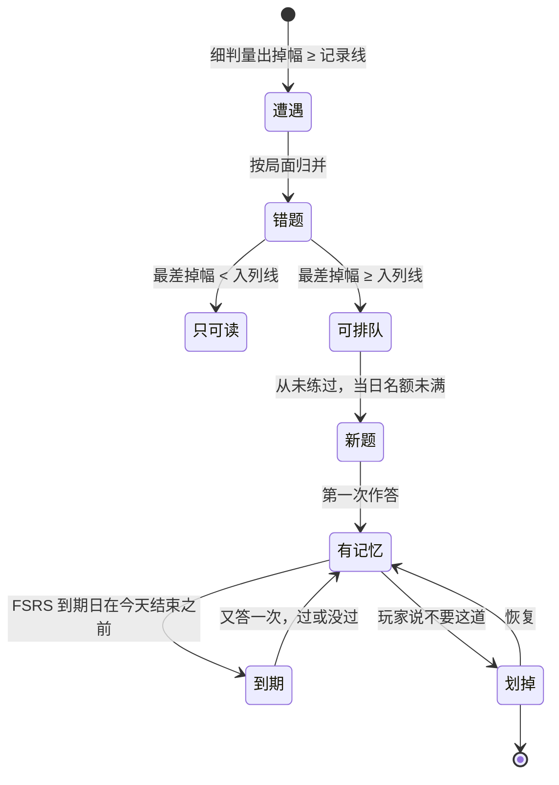

# 一道错题是怎么变成今天该做的题的

设计笔记：错题本里的一道题，从排队、到期到在日课里作答、写进练习日志的那条路。
名词在 [GLOSSARY.md](../../GLOSSARY.md) 里，为什么在 [docs/adr/](../adr/) 里，这里只说发生了什么、按什么顺序；每一步下面那行反引号是它在代码里的落点。

1. 错题本从每局的走查结果重建，玩家划掉的位置除外。
   `Sources/ChessmirrorKit/MistakeIndex.swift:rebuild`
2. 只有最差掉幅越过入列线的错题有资格排队。记录线和入列线之间的招法值得写下来看一眼，
   不值得占练习时间。
   `Sources/ChessmirrorKit/Judgement.swift:enqueues`
3. 每道错题把它在练习日志里的历次**日课**作答折成一段记忆：稳定度和难度。
   计划外的练习照样记下来，但在这里被忽略 —— 想练就练不是关于「日程本该什么时候问」的证据。
   `Sources/ChessmirrorKit/FSRS.swift:next`
4. 记忆给出下次到期日。没练过的没有记忆，也就没有到期日。
   `Sources/ChessmirrorKit/FSRS.swift:due`
5. 今天结束之前到期的进队列。一天的题从这天一开始就全部可取。
   `Sources/ChessmirrorKit/Daily.swift:forToday`
6. ARTS 给到期的排序：上次没过的排前面；过了的里面，对**这个位置**来说答得慢的排在答得快的前面。
   过期多久只用来打平手 —— 哪天该问是 FSRS 的决定，这一步不推翻它。
   `Sources/ChessmirrorKit/ARTS.swift:priority`
7. 到期的排完，用新题补位，每天十道封顶，按错题自身的紧迫度挑。
   名额按「今天已经放进来几道」算，所以开五次 app 也还是一天的量。
   `Sources/ChessmirrorKit/Daily.swift:newPerDay`
8. 玩家在日课屏答一手。一道题只关于这一手，后面都是收尾。
   `Sources/ChessmirrorKit/Drill.swift:play`
9. 同一套细判称它，同一条记录线判它过没过，应招从同一次搜索里取。
   `Sources/ChessmirrorKit/Drill.swift:judge`
10. 结果追加进练习日志：哪个局面、多久、过没过、走了什么、代价、开了几次提示、从哪来的。
    只追加，只记事实。
    `Sources/ChessmirrorKit/Drill.swift:settle`
    `Sources/ChessmirrorKit/PracticeLog.swift:append`
11. 日程是日志的函数，所以下一次的到期日在这里自动重算出来。没有任何东西被「更新」，
    换掉调度器也不需要迁移。
    `Sources/ChessmirrorKit/MistakeIndex.swift:refresh`

**这里会分叉。** 玩家可以把一个位置划掉，那也只是往日志里追加一行
（[adr/0029](../adr/0029-the-practice-log-records-what-happened-never-what-is-due.md)），随时能恢复。
答错之后开惩罚练习，反过来让玩家找那条应招（[adr/0034](../adr/0034-a-refused-move-keeps-the-reply-it-earned.md)）。

## 一道错题的一生

只可读的那一支不是死路：入列线一降，它当场就可排队了 —— 书比队列宽是可以的。

## 走一遍

以出厂的记录线和入列线（`Sources/ChessmirrorKit/Judgement.swift:JudgementLines`）为例：周二，把关开着，第 23 手。

| | |
|---|---|
| 走之前的胜率 | 61% |
| 走之后的胜率 | 34% |
| 掉幅 | 27% |
| 对记录线 10% | 超了 → 退回，写成试招，并带出应招 |
| 对入列线 10% | 超了 → 这个局面进错题本 |
| 头一次作答 | 没过 → FSRS 的 Again → 稳定度 = 权重[0] = 0.4872 天 |
| 下次到期 | 约 12 小时后，也就是周三 |
| 周三答对 | 稳定度长起来，到期日推到几天后 |
